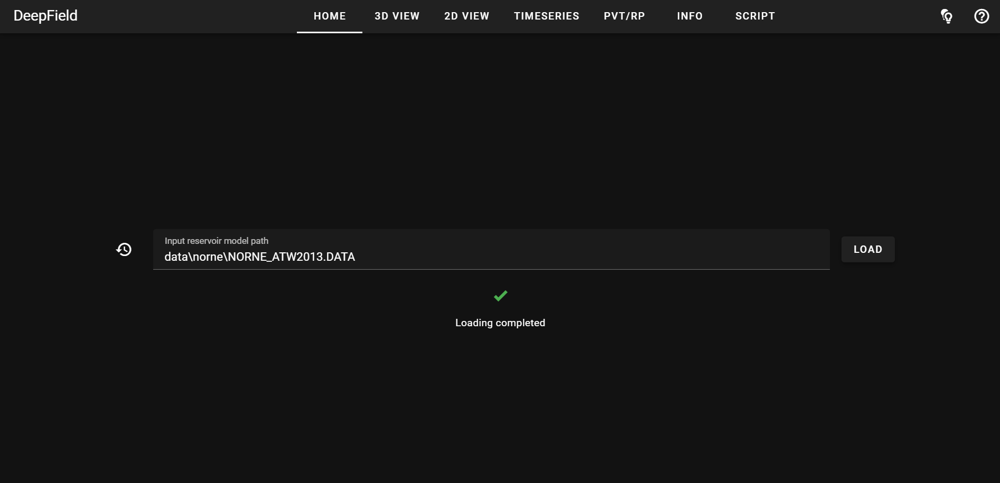
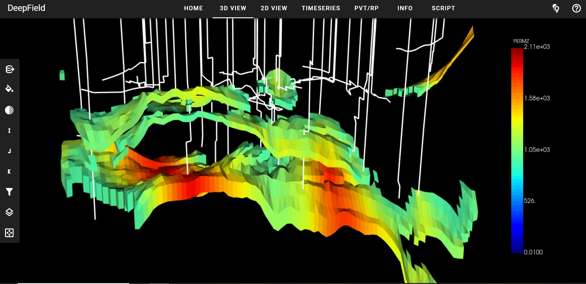
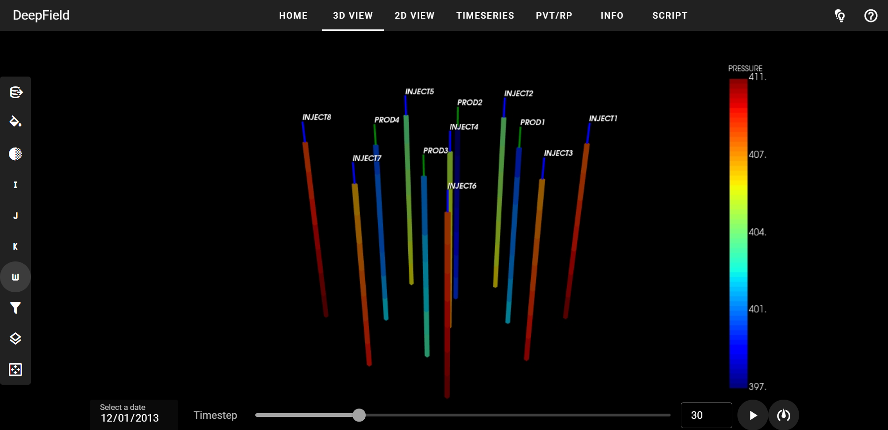
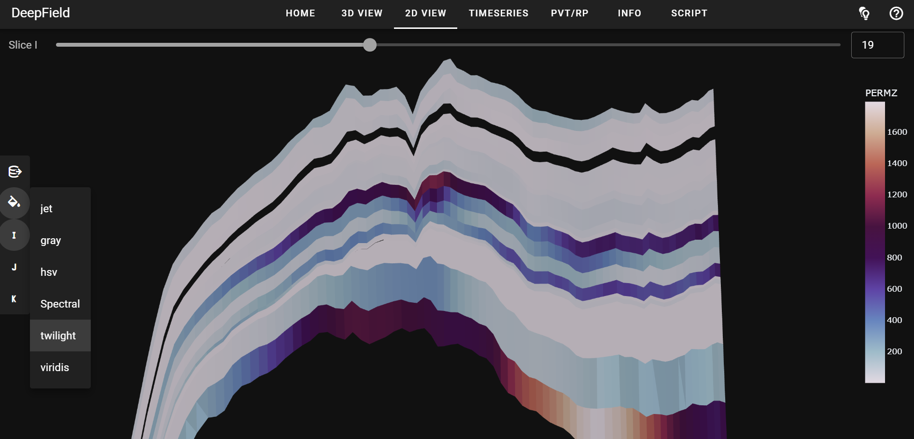
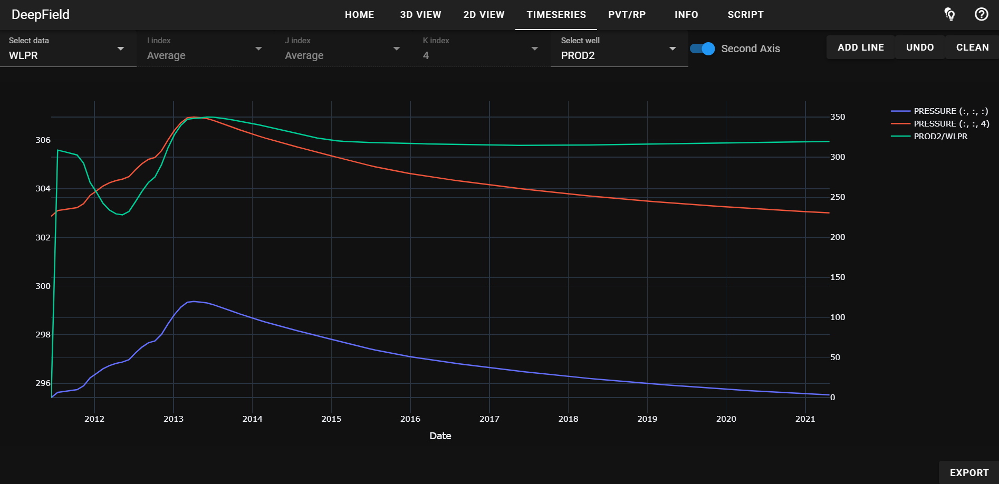
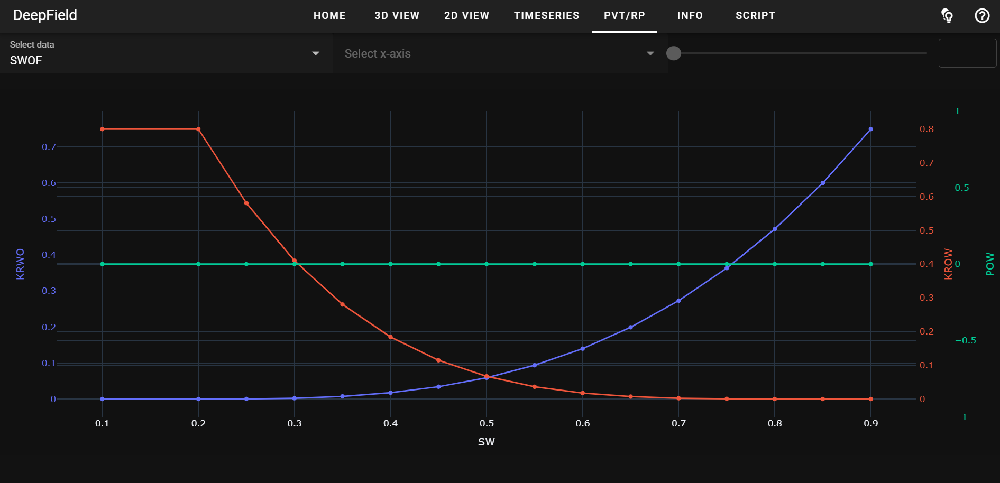
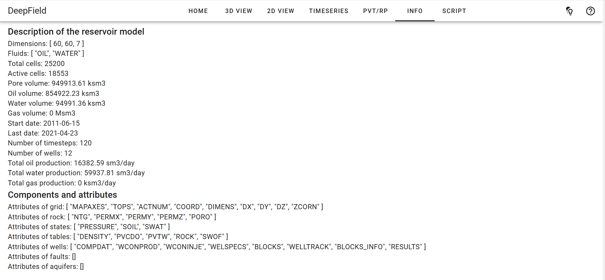
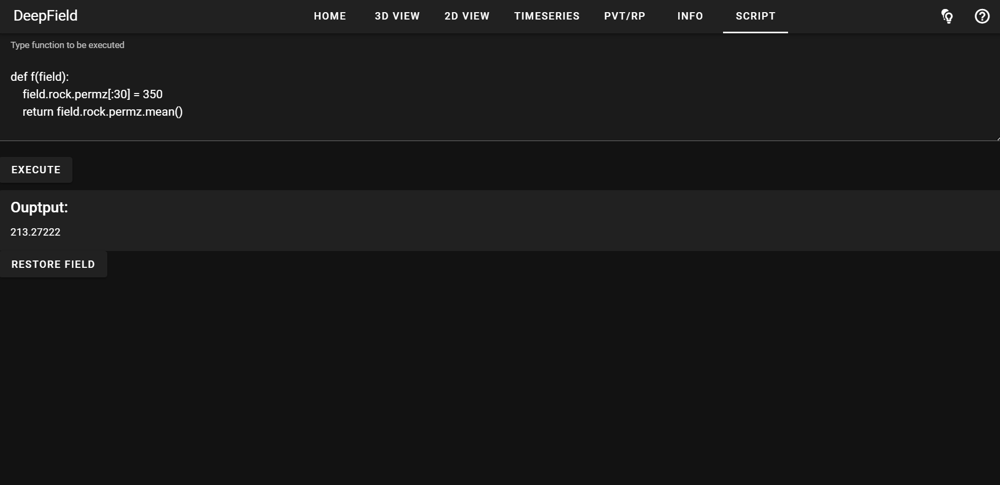
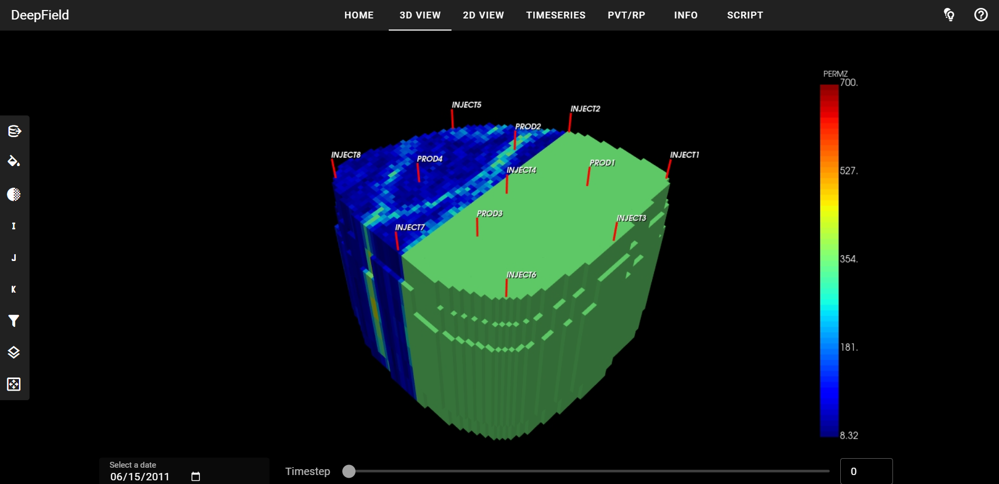

### 🌐 Multi-Language Support

**English** | [Русский](./translations/ru/README.md)

# GeoView

Web application for simulation and visualization of reservoir models.

Lightweight. Modern. Open source.

## Features

Use the application to
* read reservoir models given in ECLIPSE file format;
* simulate models using JutulDarcy simulator;
* view and explore static and dynamic data in 3D, 2D, and 1D;
* export simulated data in ECLIPSE and CSV formats;
* write and execute custom python scripts for reservoir transformations and calculations;
* work locally or on a remote server.

Main page of the application:



Simulated reservoir dynamics in 3D:


Filtering of grid cells and indication of well status (producing, injecting, inactive):



Selection of cells along well trajectories:



2D slice view:



Construction of a multiline 1D plot to compare dynamic properties:



Visualization of PVT and relative permeability tables:



Description of the reservoir model:



Script writing:



...and the results of its execution:



## Performance

Loading time and memory usage for benchmark models in the [benchmarks](./benchmarks) directory measured on a PC with Intel Core Ultra 7, 3.9GHz, 64Gb CPU:

| Number of cells | Loading time | Memory usage |
|-------|---------|---------|
| 1M | 23s | 0.5Gb |
| 10M | 3m 49s | 2.6Gb |
| 50M | 19m 26s | 10.3Gb |

## Installation as a package

We recommend creating a new virtual environment with python 3.13 to install the project dependencies:

	conda create -n app python=3.13

Activate the new environment:

	conda activate app

To install the project dependencies, run in the terminal:

    pip install "git+https://github.com/geo-kit/geocode.git"

After installation, run in the terminal:

	geoview

This should open a new tab in your default browser to http://localhost:8080/ with the application's home page.

You can add a few optional parameters to the application start command:
* --server - use to prevent a new tab from opening in the browser
* --app - use to launch the application in a separate window rather than in the browser
* --port 1234 - to change the default port 8080 to, e.g., 1234
* --agent - start GeoAgent alongside the GeoView server

### GeoAgent model selection

With `--agent`, GeoView selects the provider and model before either process
starts. The selector supports LM Studio, Ollama, and OpenAI:

```powershell
python -m geoview.app --port 8080 --agent
```

For a non-interactive launch, provide both values explicitly:

```powershell
python -m geoview.app --agent `
    --agent-provider ollama `
    --agent-model qwen2.5:7b
```

Use `--agent-base-url` for a non-default local or OpenAI-compatible endpoint:

```powershell
python -m geoview.app --agent `
    --agent-provider lmstudio `
    --agent-base-url http://127.0.0.1:1234/v1 `
    --agent-model some-model-id
```

The matching environment variables are `GEOVIEW_AGENT_PROVIDER`,
`GEOVIEW_AGENT_MODEL`, and `GEOVIEW_AGENT_BASE_URL`.

Cloud API keys are read from the environment (`OPENAI_API_KEY`). If a key is not
already set in the environment, GeoView loads it automatically from
`GeoAgent/.env`, so the simplest setup is to put the key there, one per line:

```
OPENAI_API_KEY=sk-...
```

The `--agent` launcher then picks it up without prompting, and the key is passed
only to the GeoAgent child process. GeoView does not start local model servers or
pull models.

The chat button appears on the Home tab. Ask about the model currently open (grid,
wells, phases, whether results exist), or ask the agent to find and open a model,
run the simulation, or fill in the optimization form. It fills the form and opens
the tab; starting the optimization stays with you.

When the application is running, you can click on the help icon in
the upper right corner to read a brief description of the page. 
Hover over buttons and icons to see a tooltip with textual information
about them.

 > [!NOTE]
 > Reservoir simulation requires [Julia](https://julialang.org/downloads/). Install the JutulDarcy driver dependencies once:
 >
 >     julia --project="$(python -c "import geocode, pathlib; print(pathlib.Path(geocode.__file__).parent / 'bin')")" -e "using Pkg; Pkg.instantiate()"

## Installation from source code

Another option to run the application is to clone the entire repository:

	git clone https://github.com/geo-kit/geoview.git

Addionally, you will need to clone the repository `GeoCode` into the same directory as the `GeoView`:

	git clone https://github.com/geo-kit/geocode.git

Install dependencties in both repositories using

	pip install -r requirements.txt

Then navigate to the directory DeepField-app and run in the terminal

	python -m geoview.app

to start the application.

 > [!NOTE]
 > Reservoir simulation requires [Julia](https://julialang.org/downloads/). Install the JutulDarcy driver dependencies once:
 >
 >     julia --project=../GeoCode/geocode/bin -e "using Pkg; Pkg.instantiate()"


## Rendering options

By default, rendering is performed locally in the user's browser using vtk webassembly functionality.
To enable vtk remote rendering, use the `-vr` or `--vtk_remote` option when starting the application. 
Note that the functionality of the application is slightly different between local and remote rendering.

## Open-source reservoir models

An example reservoir model with dynamics simulation can be found in the `open_data` directory in the `GeoCode` repository [https://github.com/geo-kig/GeoCode](https://github.com/geo-kit/GeoCode),
as well as links to a number of other open source models.

## Script writing

The application allows you to write and execute python scripts for
reservoir model transformations and calculations. The script should 
be based on the `GeoCode` framework 
[https://github.com/geo-kit/GeoCode](https://github.com/geo-kit/GeoCode).
Read the [documentation](https://geo-kit.github.io/GeoCode/)
and see
[examples](https://github.com/geo-kit/GeoCode/tree/main/notebooks)
in the `GeoCode` repository to prepare a script.

## Next releases

The project is developing. We are preparing new releases with new features.
Your suggestions and issues reports will help to make the application even better.

## What's inside

We use
* [trame](https://github.com/Kitware/trame) to build the web application
* [GeoRead](https://github.com/geo-kit/GeoRead) to read and [GeoCode](https://github.com/geo-kit/GeoCode) to process reservoir models
* [JutulDarcy](https://github.com/sintefmath/JutulDarcy.jl) for reservoir simulation

## Citing

We hope that this project will help you in your research and you will decide to cite it as
```
GeoView web application (2026). GitHub repository, https://github.com/geo-kit/GeoView.
```
